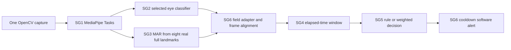

# SG6 system architecture

Canonical entry `embedded_sg6/app.py`. Config `embedded_sg6/config.json`; CLI overrides select source, model, GUI, frame limit and output paths. `Pipeline` initializes reusable modules once. Input frame and timestamp are shared. VIDEO timestamps derive from verified container FPS; live read completion uses monotonic_ns; performance uses perf_counter_ns. Replayed source timestamps are preserved in SG2/SG3; existing SG4 truncates to integer milliseconds. Strict increasing source timestamps prevent stale replay. This does not add a new V1 contract or claim a formally approved shared schema exists.

SG1 nested records are flattened only at adapter boundary. SG2's frozen JSON Schema is validated with a cached Draft202012Validator every frame. SG2 `eye_valid`/`eye_state` -> SG4 `eyes_valid`/nullable `eyes_closed`; matching frame IDs/timestamps enforced. SG3 eight inner lip points use indices 78,82,13,312,308,317,14,87 from actual full landmarks. SG1 four-point mouth remains unchanged. Missing optional landmarks produce unknown mouth evidence. A model confidence score is never invented. SG3 sigmoid output and SG5 scores are heuristic, not calibrated probabilities.

Driver policy: configure normalized driver_region for the seat. If multiple faces occur inside it, mark observation unknown rather than selecting a different person by largest area. With one face, SG1's region selection is used. Identity continuity through a completely replaced single face is not verified; reset/recalibration is required for a new driver. Driver region must be established on the vehicle.

Unknown current face/eyes gates SG5 invalid even if historical window remains valid. Pending SG2 blink is cancelled on missing face or gap > SG4 max_gap_ms, without emitting an inferred blink. SG4 remains the authoritative time-based closure/event window. Its default warmup=5000 ms and unvalidated thresholds remain unchanged. Pipeline validation errors emit explicit INVALID records, reset histories and continue; five consecutive module errors stop. Camera read failure stops in UNKNOWN with a clear error. No automatic reconnect is promised. Capture/detector/file/GUI resources close via ExitStack; Ctrl+C is handled. Alert sink exceptions are reported as alert_error rather than confirming successful output.

Synchronous capture is selected: one outstanding frame, no producer queue or thread shutdown problem. Latest-frame threading is deferred until target camera-buffer latency is measured. Hidden backend buffering and frame drops are unknown. Full frame landmark output is needed for SG3; SG1 currently also creates three ROI copies. No change to that code was justified by target profiling. RGB conversion, detector and landmarks are currently measured together as sg1_ms because the upstream Tasks call combines inference stages.

JSONL is streamed (no accumulated frame/video buffer). Metrics aggregate means/maxima and sampled RSS. Processing FPS includes input/model startup after Pipeline initialization and output work; it is not sensor FPS. read_complete_to_decision_ms excludes sensor exposure/backend buffering; physical camera-to-alert delay is unavailable. Software alerts are JSON stderr events with monotonic cooldown, not a buzzer. Physical hardware integration should implement an alert sink update(decision, monotonic_ms), report failures, and retain cooldown gating.
